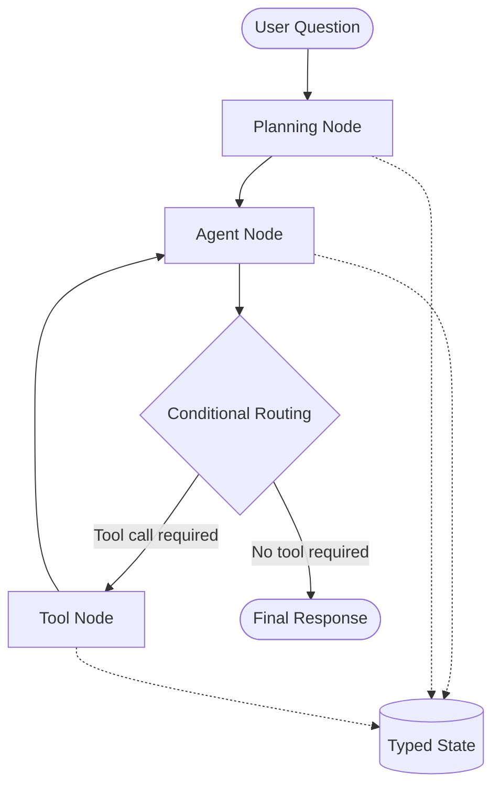

# 📊 Insight Copilot

**An AI-powered Sales Data Analysis Assistant built using LangGraph, Groq, Python, and Streamlit.**

Insight Copilot is a conversational analytics chatbot that allows users to explore sales data using natural language. Instead of manually writing queries or analyzing spreadsheets, users can ask questions and receive data-driven answers, supporting calculations, and visualizations.

## 🚀 Features

- **Natural Language Queries:** Ask questions about sales data in plain English.
- **AI-Powered Reasoning:** Uses LangGraph to manage the analysis workflow and decide which tools to execute.
- **Multiple Analytical Tools:** Supports sales data queries, metric calculations, and chart generation.
- **Analysis Plan:** Displays a short analysis plan before executing the request.
- **Data Visualization:** Generates interactive charts using Plotly.
- **Multi-turn Conversations:** Maintains conversation history during a session.
- **Interactive Interface:** Built with Streamlit for an easy-to-use chatbot experience.

## 🛠️ Technology Stack

| Technology | Purpose |
|---|---|
| Python | Core programming language |
| LangGraph | Workflow orchestration and conditional routing |
| LangChain | LLM and tool integration |
| Groq | LLM inference |
| Pandas | Data processing and analysis |
| Plotly | Interactive data visualization |
| Streamlit | Chatbot user interface |
| Excel | Sales dataset storage |

## 🧠 Architecture

Insight Copilot follows a tool-using agent architecture implemented using LangGraph.

1. **User Input:** The user submits a natural-language question.
2. **Planning Node:** Generates a short, user-visible analysis plan.
3. **Agent Node:** Determines which analytical tool is required.
4. **Conditional Routing:** Routes the workflow to the appropriate tool when a tool call is required.
5. **Tool Execution:** Executes the selected data query, calculation, or chart-generation tool.
6. **Final Response:** Returns the answer with supporting results and relevant insights.

The workflow uses a typed state and conditional edges to manage execution.




## 📁 Project Structure

```text
Insight_copilot/
│
├── agent/
│   ├── __init__.py
│   ├── tools.py
│   └── graph.py
│
├── data/
│   └── Sales_Dataset_2024.xlsx
│
├── notebooks/
│
├── app.py
├── requirements.txt
├── README.md
└── .gitignore
```

## 📊 Dataset

The project uses a sample sales dataset containing 2,000 records from 2024.

**Dataset columns:**
- Date
- Region
- Product
- Salesperson
- Units_Sold
- Unit_Price
- Category
- Revenue
- Cost
- Profit

The dataset supports regional, product-level, category-level, and overall sales analysis.

## ⚙️ Installation and Setup

### 1. Clone the repository

```bash
git clone https://github.com/khandekartanvi13-hub/Insight_copilot.git
cd Insight_copilot
```

### 2. Install dependencies

```bash
pip install -r requirements.txt
```

### 3. Configure the Groq API key

Create an API key through the Groq Console.

Set it as an environment variable:

```bash
export GROQ_API_KEY="your_groq_api_key"
```

On Windows PowerShell:

```powershell
$env:GROQ_API_KEY="your_groq_api_key"
```

### 4. Run the application

```bash
streamlit run app.py
```

Open the local URL displayed in the terminal to access the chatbot.

## 💬 Example Questions

Users can ask questions such as:

- Which region generated the highest revenue?
- Which product generated the highest profit?
- What is the total revenue?
- Compare revenue across product categories.
- Create a chart showing revenue by region.

## 🔐 Security

- API keys are stored as environment variables or Streamlit secrets.
- Sensitive credentials are not committed to the GitHub repository.

## 🌐 Live Application

**Streamlit App:**

[Launch Insight Copilot](https://insightcopilot-2tvaa4cawqf9hvzweoeqhj.streamlit.app/)]

## 👩‍💻 Author

**Tanvi Khandekar**

GitHub: https://github.com/khandekartanvi13-hub

